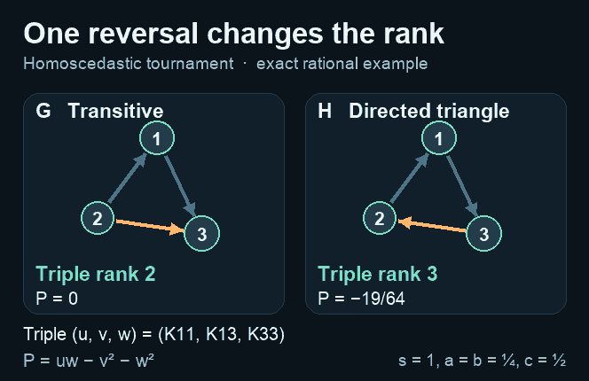

# Edge reversal changes Jacobian matroids of homoscedastic tournaments

Wu’s dissertation reports computations that imply small counterexamples to the edge-reversal conjecture for labelled Jacobian matroids. This release supplies explicit exact certificates, separates the abstract matroids on three vertices, and extends strongly connected labelled counterexamples to every size from four onward. [Wu’s dissertation, §5.4.1, p. 63](https://mediatum.ub.tum.de/doc/1713538/document.pdf#page=79)

[Paper PDF](paper/manuscript.pdf) · [LaTeX source](paper/manuscript.tex) · [Catalog Q505](https://github.com/10m-u/open-problems-catalog/blob/ca8d4d44ba3db527f19f28928c240168f545ecfe/problems/statistics_data_science/experimental-design-causal-inference.md#q505) · [Conjecture 5.4](https://arxiv.org/pdf/2308.01821#page=19)

## One edge reversal

The arrow $2\to3$ in a transitive tournament reverses to $3\to2$ to create a directed triangle. Put $(u,v,w)=(K_{11},K_{13},K_{33})$. The transitive tournament satisfies $uw-v^2-w^2=0$ identically. For the directed triangle the same polynomial is −19/64 at the worked point, where a Jacobian minor in $(s,b,c)$ is −15/16. The generic rank goes from two to three.

[Download the offline explorer ZIP](https://raw.githubusercontent.com/DannyExperiments/homoscedastic-tournament-matroid-edge-reversal/v1.0.0/visualization/homoscedastic-tournament-matroid-edge-reversal-explorer.zip) · [Worked example and rendering guide](visualization/README.md)

## Proof and prior work

The proof shows that all twenty triples of coordinates are independent in the directed triangle. It also gives a four-coordinate witness for a strongly connected pair and an extension that preserves those coordinates in every larger size. The journal’s listed Macaulay2 comparison follows a code path restricted to off-diagonal entries. The conjecture uses the full ground set including diagonals. [Source and literature audit](audits/public_safe_reports/LITERATURE_AUDIT.md) · [Exact scope](CLAIM_SCOPE_AND_LIMITATIONS.md)

## Verification and citation

The [exact replay](REPRODUCIBILITY.md) computes small matrices, ranks and rational values. The [partial Lean certificate](formal/Q505Certificate.lean) verifies the selected algebraic identities, derivative coefficients and rational evaluations at size three. The matroid criterion and extensions are proved in the paper. Internally reviewed, not peer reviewed. [Review status](STATUS.md) · [Research disclosure](AI_DISCLOSURE.md)

DannyExperiments is the preferred citation identity. [Release v1.0.0](https://github.com/DannyExperiments/homoscedastic-tournament-matroid-edge-reversal/releases/tag/v1.0.0) · [Version DOI](https://doi.org/10.5281/zenodo.24571506) · [Citation metadata](CITATION.cff)
