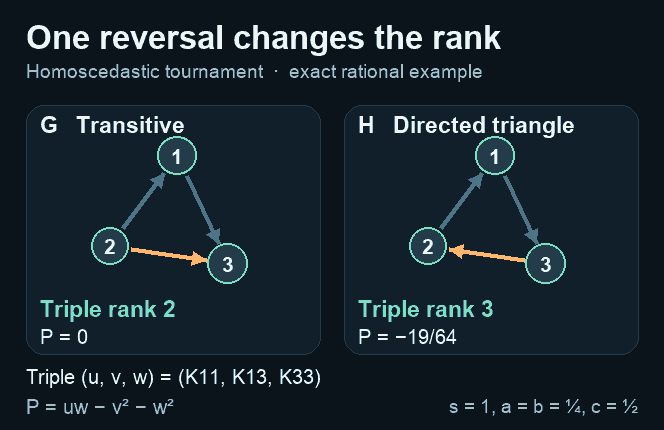

# One reversal changes the rank

[Download the offline explorer ZIP](https://raw.githubusercontent.com/DannyExperiments/homoscedastic-tournament-matroid-edge-reversal/v1.0.0/visualization/homoscedastic-tournament-matroid-edge-reversal-explorer.zip). Extract it and open `index.html` in a browser. Choose G or H to reverse the amber arrow. Use the slider to rotate the perspective view. The coordinates and rank remain fixed as the camera moves.



Both graphs contain 2 → 1 and 1 → 3. The remaining edge is 2 → 3 in G and 3 → 2 in H. The chosen coefficients are $s=1$, $a=b=1/4$, $c=1/2$. The selected triples $(K_{11},K_{13},K_{33})$ are $(17/16,-1/4,1)$ and $(17/16,-1/4,5/4)$. Their values under $P=uw-v^2-w^2$ are 0 and −19/64. The polynomial identity for G and the nonzero derivative minor for H certify the generic ranks.

The illustration concerns the first worked example. The [manuscript](../paper/manuscript.pdf) proves the all-triples statement and the strongly connected extension.

Render the rotating GIF from the repository root with an existing Python environment that includes Pillow and either Arial or DejaVu Sans.

```sh
python3 visualization/render.py
```

The HTML is self-contained. [Exact replay](../REPRODUCIBILITY.md) verifies the displayed fractions from the full graph matrices.
